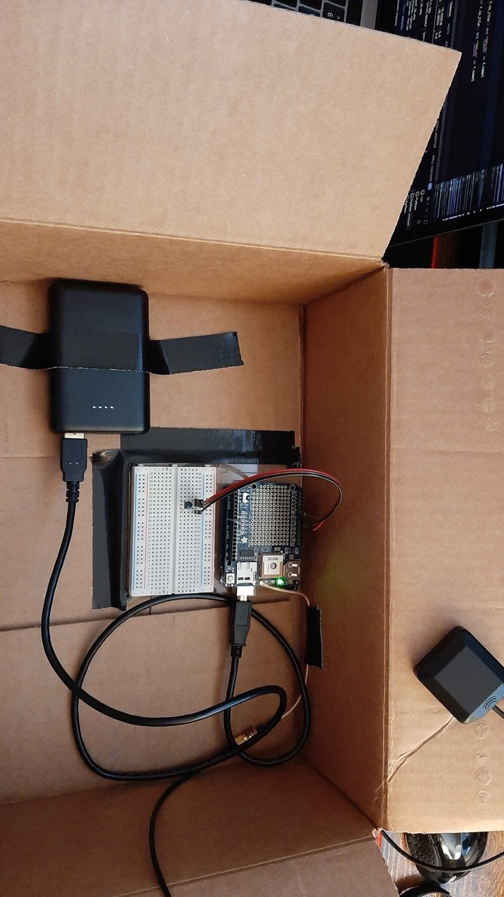
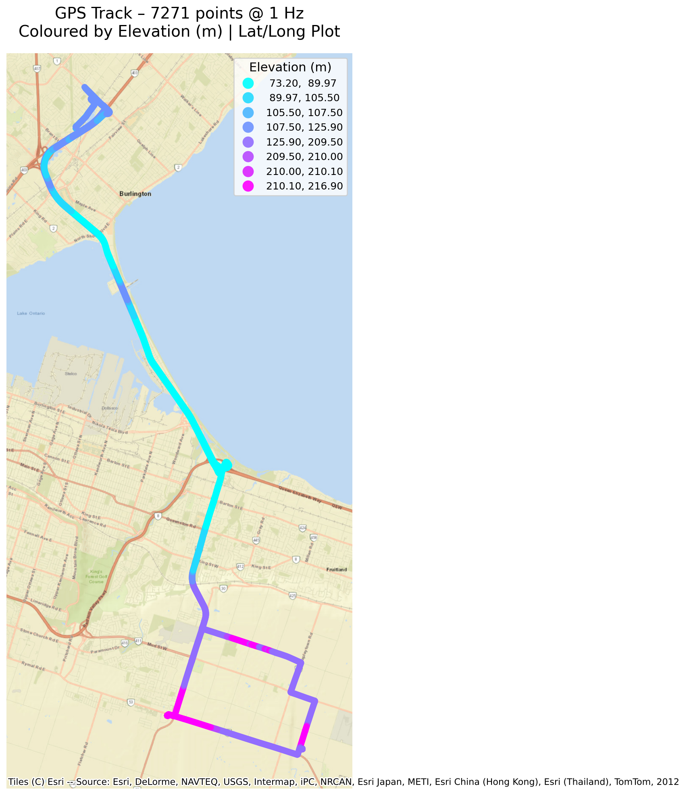
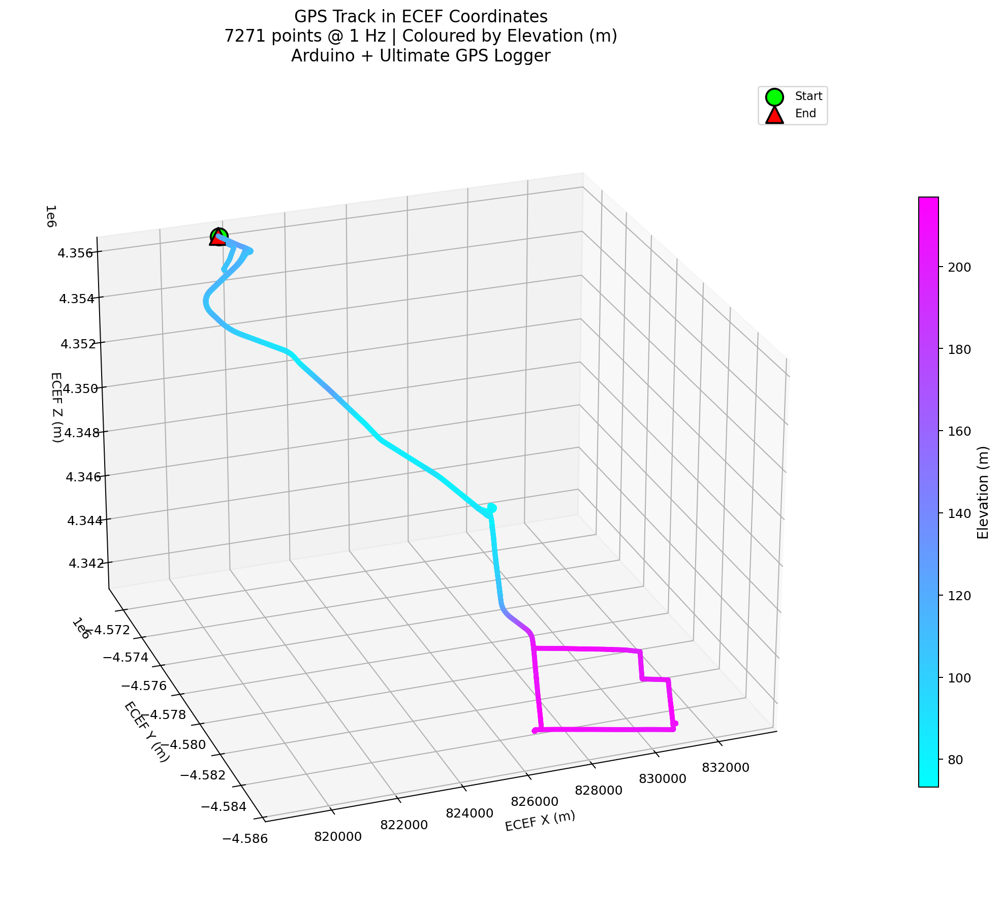
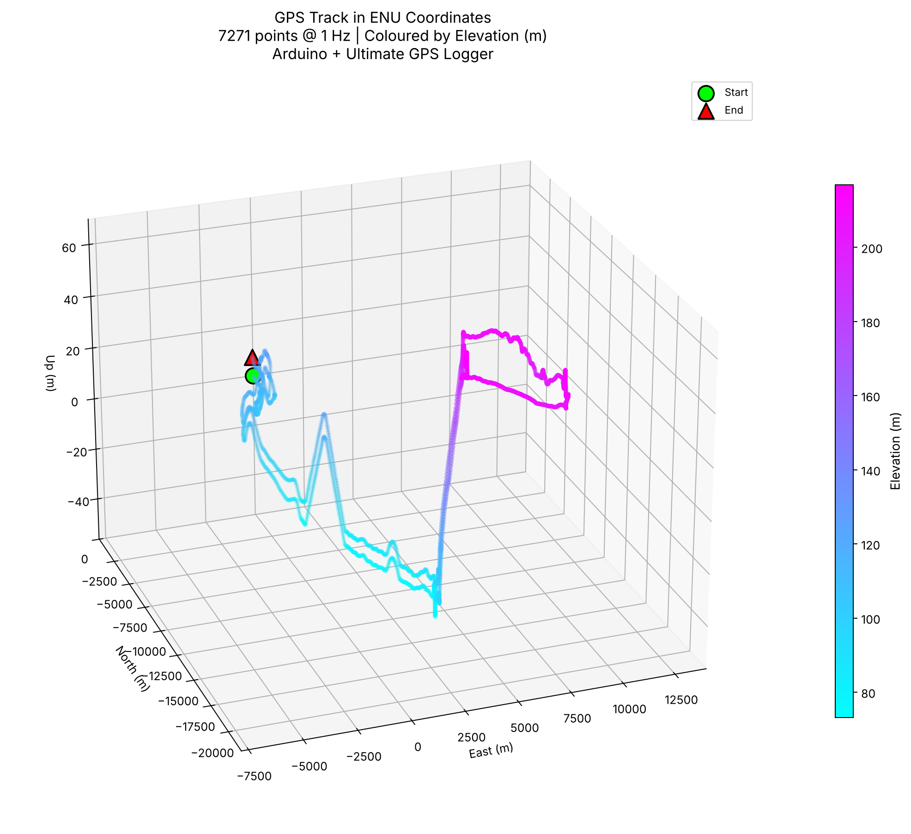

# GPS + Temperature Data Logger

**Project write-up:** [sheetmars.github.io/projects/gps-data-logger](https://sheetmars.github.io/projects/gps-data-logger/)

An Arduino-based field logger that records 1 Hz GPS position and 0.1 Hz temperature to an SD card. A Python pipeline then parses the raw NMEA logs, fuses the two sensor streams and plots the track in three coordinate frames: geodetic (lat/long on a basemap), Earth-Centred Earth-Fixed (ECEF), and a local East-North-Up (ENU) frame.

I built it to practise the full chain from sensor to deliverable: hardware setup, firmware, field collection, parsing, sensor fusion, and coordinate-frame transformations. The data in this repo comes from a round-trip drive between Burlington and Hamilton, Ontario in March 2026 (about 2 hours, ~7,300 fixes).



## Hardware

| Component | Role |
|---|---|
| Arduino Uno | Microcontroller |
| Adafruit Ultimate GPS + Logging Shield (MTK3339) | GPS receiver and SD card writer |
| External GPS SMA antenna | Better reception than the shield's built-in patch antenna |
| TMP36 analog temperature sensor | Ambient temperature (signal → A0, + → 5 V, − → GND) |
| USB power bank | Field power |

## How it works

**Firmware** ([`arduino_logger_code/shield_sdlog.ino`](arduino_logger_code/shield_sdlog.ino))
- Reads NMEA sentences from the GPS on a timer interrupt and writes the RMC and GGA sentences to `GPSLOGxx.TXT` once per second.
- Every 10 seconds, when the GPS has a fix, it reads the TMP36 and writes a timestamped line to a separate `TMPLOGxx.TXT`.

**Processing** ([`parser.py`](parser.py), or step by step in [`gps_data_analysis.ipynb`](gps_data_analysis.ipynb))
1. **Parse** the raw `$GPGGA` sentences: UTC time, satellite count, lat/long (converted from degrees-decimal-minutes), and altitude. Parse speed over ground from `$GPRMC`.
2. **Fuse** the 0.1 Hz temperature stream with the 1 Hz position stream. The script joins them on time and linearly interpolates temperature to 1 Hz, then saves the result to `data.parquet`.
3. **Transform** WGS84 geodetic coordinates to ECEF (X, Y, Z), then rotate them into a local ENU frame whose origin is the first fix.
4. **Plot** the drive three different ways, coloured by elevation.

## Results



| ECEF (global Cartesian) | ENU (local, origin at first fix) |
|---|---|
|  |  |

The ENU frame is the most practical view for site-scale work, because positions read directly as metres east, north and up from a chosen origin. ECEF is the intermediate step that gets you there.

## Running it

```bash
git clone https://github.com/sheetmars/gps-data-logger.git
cd gps-data-logger
python -m venv .venv && source .venv/bin/activate
pip install -r requirements.txt
python parser.py
```

The 3D plots open in interactive windows; close one to show the next. Every plot is also saved as a PNG in `images/`.

To log your own data, flash the sketch (Arduino library: **Adafruit GPS Library v1.1.3**), collect, and copy the `.TXT` files from the SD card into `data/`.

## Notes

- **Privacy:** I trimmed the logs in `data/` to remove everything within 1.5 km of the start and end points.
- **Temperature:** temperature was logged to practise merging datasets with different sampling rates. It isn't plotted, because the variation over the drive wasn't interesting.
- **Firmware:** the sketch is based on Adafruit's `shield_sdlog` example (Ladyada, modified by Bill Greiman). I added the TMP36 reading, the second log file, and the 10-second fix-gated temperature logging.
- **AI Use:** The parsing and plotting code was written with AI assistance. My focus was the hardware build, field data collection, and the geodetic → ECEF → ENU workflow.

## License

MIT for my own code. See [LICENSE](LICENSE). The Adafruit-derived portions of the sketch remain under Adafruit's original license.
